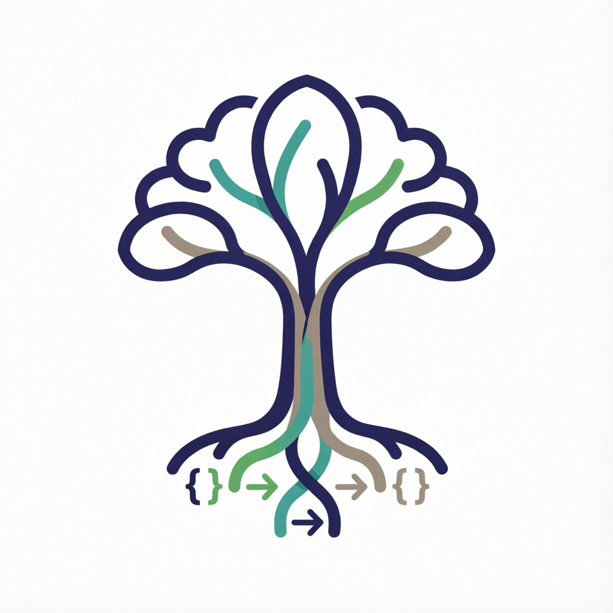

# CodeGraphX

<p align="center">
  
</p>

<p align="center">
  <a href="https://www.npmjs.com/package/codegraphx"></a>
  <a href="https://www.npmjs.com/package/codegraphx"></a>
  <a href="LICENSE"></a>
  <a href="https://nodejs.org"></a>
  <a href="https://modelcontextprotocol.io"></a>
</p>

> **CodeGraphX (CGX)** is a local, token-efficient **codebase graph engine** for AI coding agents and human developers. It parses your source with Tree-sitter, stores a bi-temporal semantic graph in SQLite, and serves it over a **CLI** and an **MCP server** — so an agent can ask *"what breaks if I change this function?"* and get an exact answer in a few hundred tokens instead of reading 50 files.

---

## What is CodeGraphX?

**Definition —** CodeGraphX is a *code intelligence layer*: a persistent, queryable graph of your codebase's symbols (functions, classes, variables), their relationships (`calls`, `called_by`, `imports`, `inherits`, cross-language `API_CALLS`), and how they change over time.

**What kind of tool is it?** It sits in the same family as a Language Server (LSP) or a code-search index, but it is purpose-built for **LLM agents**:

- A **Language Server** answers "go to definition" for an editor, one symbol at a time.
- A **grep / embedding search** finds text, not structure.
- **CodeGraphX** answers *structural, whole-repo reasoning questions* — impact/blast-radius, dependency cycles, cross-language contracts, "does this symbol even exist?" — and serializes the answer in a **token-optimized** form an agent can drop straight into its context.

**The core problem it solves —** AI coding agents burn most of their token budget *re-discovering* a codebase: opening files, scrolling, grepping, re-reading the same modules every session. CodeGraphX indexes once and answers those questions from a graph, so the agent spends tokens *reasoning* instead of *scanning*.

---

## Why it's useful (the token economics)

Every agent action has a token cost. Consider a common question: **"What will break if I change `validateInput`?"**

| Approach | What the agent does | Rough context cost |
|---|---|---|
| **No CGX** | Greps for `validateInput`, opens ~15–50 candidate files, reads each to trace call sites | **tens of thousands** of tokens, several tool round-trips |
| **With CGX** | `explain_impact({ symbol_name: "validateInput" })` → one small JSON of upstream callers + downstream callees | **a few hundred** tokens, one round-trip |

The savings compound because CGX serializes its graph in **TOON** (Token-Oriented Object Notation) instead of JSON — a compact tabular encoding that removes the repeated keys and braces that dominate JSON token counts.

> **Honest framing:** the accuracy numbers below are measured against a hand-labeled corpus. The token figures above are an *illustrative model* of typical agent behavior, not a lab benchmark — the exact ratio depends on your repo and agent. The mechanism (one targeted graph query vs. many file reads) is what delivers the win.

**Where CGX pays off most:**
- Large / unfamiliar repos where "read everything" is infeasible.
- Long agent sessions (the graph is a cache the agent doesn't have to rebuild).
- Cross-language stacks (React ⇄ Express/Flask/FastAPI) where call graphs don't span files.
- Refactors and reviews, where blast-radius and dead/broken-import detection matter.

---

## Full capabilities

| Capability | What it gives you |
|---|---|
| 🧠 **Symbol graph** | Every function/class/method with `calls`, `called_by`, `imports`, `inherits` edges |
| ⚡ **O(1) symbol lookup** | Bloom filter answers `probable_yes` / `definite_no` without touching the DB |
| 💥 **Impact tracing** | Recursive upstream (callers) / downstream (callees) blast-radius via a SQL CTE |
| 🌉 **Cross-language linking** | Matches frontend `fetch`/`axios` calls to backend routes as confidence-scored `API_CALLS` edges |
| 🕑 **Bi-temporal history** | Append-only graph — query the codebase *as of any commit*; nothing is ever destroyed |
| 🩺 **Doctor diagnostics** | Reports missing/unresolvable imports, unresolved call targets, circular dependencies, syntax errors |
| ✅ **Task verification** | Compares a task description against a commit's actual symbol changes; flags untested additions |
| 🔀 **Session / branch diff** | Structural summary of added/removed/modified symbols vs. HEAD or a branch |
| 🌐 **Interactive dashboard** | D3.js force graph of the whole codebase in the browser |
| 📦 **TOON artifacts** | Token-optimized graph + file-index exports for agent context injection |
| 🔐 **100% local** | No cloud, no telemetry, no network — code never leaves the machine |
| 🤖 **MCP server** | 6 tools exposed to any MCP-compatible agent, with zero-config auto-indexing |

---

## Tech used in this project

| Layer | Technology |
|---|---|
| **Parsing** | [Tree-sitter](https://tree-sitter.github.io/) with per-language grammars (`tree-sitter-python`, `-javascript`, `-typescript`, `-html`, `-css`) |
| **Storage** | SQLite via [`better-sqlite3`](https://github.com/WiseLibs/better-sqlite3) (default) or **Postgres** (`pg`), through the [Kysely](https://kysely.dev/) type-safe query builder |
| **Agent protocol** | [Model Context Protocol SDK](https://modelcontextprotocol.io/) (`@modelcontextprotocol/sdk`) over stdio |
| **Probabilistic lookup** | [`bloom-filters`](https://github.com/Callidon/bloom-filters) |
| **Token-optimized output** | [TOON](https://github.com/toon-format/toon) (`@toon-format/toon`) |
| **CLI** | [Commander](https://github.com/tj/commander.js) + [`@clack/prompts`](https://github.com/natemoo-re/clack) for the interactive setup |
| **File watching** | [chokidar](https://github.com/paulmillr/chokidar) |
| **Runtime** | Node.js ≥ 18, CommonJS |

---

## Supported languages

| Language | Extensions | Extracts |
|---|---|---|
| Python | `.py` | functions, classes, calls, imports (incl. package-relative `.` / `..`), Flask/FastAPI routes |
| JavaScript | `.js`, `.jsx` | functions, classes, arrow fns, calls, imports/`require`, local bindings, `fetch`/`axios` calls, Express routes |
| TypeScript | `.ts`, `.tsx` | same as JS plus TS-specific declarations |
| HTML | `.html` | elements / structural symbols |
| CSS | `.css` | selectors (classes, ids) |

---

## Installation

```bash
# Global (recommended)
npm install -g codegraphx

# Or per-project
npm install --save-dev codegraphx

# Verify
codegraphx --version        # 1.2.4
```

The CLI is available as `codegraphx`, `cgx`, and the MCP entrypoint `cgx-mcp`.

---

## Quick start

```bash
cd your-project

# 1. Index the codebase → writes .codegraphx/ + .codegraphx.db
cgx init

# 2. Ask questions
cgx query authenticateUser                       # where is it, what calls it, what it calls
cgx impact authenticateUser --direction downstream --depth 5
cgx impact authenticateUser --direction upstream
cgx stats                                        # files / symbols / edges
cgx doctor                                       # health report

# 3. Optional live view
cgx watch                                        # re-index on file change
cgx dashboard                                    # open the D3 graph in a browser
```

> **Re-scanning is a full rewrite.** Each `cgx init` / `cgx scan` rebuilds `.codegraphx/` from scratch: files deleted from disk are evicted from the graph, stale artifacts are wiped, and the database temporal-closes removed symbols — so the graph always matches your working tree. Unchanged files are still served from cache, so it stays fast.

### CLI command reference

| Command | Purpose |
|---|---|
| `cgx setup` | Wire the MCP server + skill into your coding CLIs (see below) |
| `cgx init` / `cgx scan` | Full index of the codebase |
| `cgx query <symbol>` | Show a symbol's file, type, `calls`, and `called_by` |
| `cgx impact <symbol> [--direction up/downstream] [--depth N]` | Trace the blast radius |
| `cgx doctor [--json] [--strict] [--no-calls]` | Diagnostics: imports, calls, cycles, syntax |
| `cgx stats` | Counts of files / symbols / functions / classes / edges |
| `cgx watch` | Auto-update the graph on file changes |
| `cgx dashboard` | Open the interactive `codegraph.html` |
| `cgx git-hook <install\|remove>` | Auto-scan on `post-commit` / `pre-push` |
| `cgx session summary [--branch <b>]` | Structural change summary for the current session |
| `cgx verify --task <desc> --commit <hash>` | Task-vs-commit verification evidence |

---

## MCP server (for AI agents)

CodeGraphX ships an MCP stdio server exposing 6 tools. **Zero-setup:** you don't have to scan first — on its first start in a project, the server indexes the codebase in the background. While indexing, `get_graph_status` reports `"indexing"`; once `"ready"`, all tools are live.

### Available MCP tools

| Tool | Description | Parameters |
|---|---|---|
| `get_graph_status` | Readiness: `indexing` / `ready` / `error`, plus file count | — |
| `list_files` | List indexed files | `filter?: string` |
| `check_symbol_exists` | O(1) Bloom lookup → `probable_yes` / `definite_no` | `name: string` |
| `explain_impact` | Upstream callers + downstream callees of a symbol | `symbol_name: string` |
| `verify_task` | Compare a task description to a commit's real changes | `task_description: string`, `commit_hash?: string` |
| `get_session_diff` | Structural summary of the current session/branch | `branch?: string` (default `HEAD`) |

### Example agent workflow

```
User: "What breaks if I change the validateInput function?"

Agent (via MCP):
  1. check_symbol_exists({ name: "validateInput" })   → { exists: "probable_yes" }
  2. explain_impact({ symbol_name: "validateInput" })
       → { used_by_upstream: ["src/auth.js::login"],
           breaks_downstream: ["src/api.js::handleRequest"] }

Result: exact answer, no file scanning.
```

### Picking the project root

The server indexes the directory it starts in. If your client doesn't set one, pass it explicitly:

```bash
cgx-mcp --project-root /path/to/project
# or
CGX_PROJECT_ROOT=/path/to/project cgx-mcp
```

---

## Setup — how easy is it?

### One command

```bash
cgx setup
```

It **auto-detects** the coding CLIs you have installed, lets you multi-select which to configure, and wires each one — no hand-editing config, no hunting for absolute paths. It registers the MCP server (via each CLI's native command where available, with a JSON-file fallback) using an **absolute Node path + the bundled `cgx-mcp`**, so it works for both global and local installs, and it installs the CGX usage skill/instructions in each CLI's format.

```bash
cgx setup                                   # interactive multi-select
cgx setup --agents claude,gemini --yes      # non-interactive (CI / scripted)
cgx setup --project                         # register for the current repo only
```

Registration is **user/global by default**, so you run it once and it works in every project — `cgx-mcp` resolves the project from wherever your CLI launches. Existing config is preserved; a backup is written before the first edit.

### Supported coding-agent CLIs

| Agent | Detected via | MCP registration | Skill / instructions |
|---|---|---|---|
| **Claude Code** | `claude` on PATH or `~/.claude` | `claude mcp add` → `~/.claude.json` or `.mcp.json` | `~/.claude/skills/cgx/SKILL.md` |
| **Gemini CLI** | `gemini` on PATH | `~/.gemini/settings.json` or `.gemini/settings.json` | `GEMINI.md` (context file) |
| **Antigravity CLI** | `agy` on PATH | `~/.gemini/config/mcp_config.json` or `.agents/mcp_config.json` | `~/.gemini/skills/cgx/SKILL.md` or `.agents/skills/cgx/SKILL.md` |
| **OpenCode** | `opencode` on PATH | `opencode mcp` → config file | `AGENTS.md` |
| **Cursor** | `~/.cursor` present | `~/.cursor/mcp.json` or `.cursor/mcp.json` | `.cursor/rules/*.mdc` |

Then open your CLI in any project and say *"use cgx to explore this codebase."*

### If `cgx setup` doesn't work — manual setup

The MCP entry is always the same shape: run the bundled `cgx-mcp` with an **absolute path to `node`** (some clients don't inherit your shell `PATH`). Find them with:

```bash
which node                    # e.g. /usr/local/bin/node
which cgx-mcp                 # e.g. /usr/local/lib/node_modules/codegraphx/bin/cgx-mcp
```

**Claude Code** — from your project:
```bash
claude mcp add codegraphx -- npx -y -p codegraphx cgx-mcp
```
or `.mcp.json`:
```json
{ "mcpServers": { "codegraphx": { "command": "npx", "args": ["-y", "-p", "codegraphx", "cgx-mcp"] } } }
```

**Claude Desktop** — `~/Library/Application Support/Claude/claude_desktop_config.json` (macOS). No project dir, so set the root:
```json
{ "mcpServers": { "codegraphx": {
  "command": "npx",
  "args": ["-y", "-p", "codegraphx", "cgx-mcp", "--project-root", "/path/to/project"]
} } }
```

**Gemini CLI** — `.gemini/settings.json` (use an absolute `node` path):
```json
{ "mcpServers": { "codegraphx": {
  "command": "/ABSOLUTE/PATH/TO/node",
  "args": ["/ABSOLUTE/PATH/TO/node_modules/codegraphx/bin/cgx-mcp"],
  "cwd": "/ABSOLUTE/PATH/TO/PROJECT"
} } }
```

**Antigravity CLI** (`agy`) — file-only, no native command. Global `~/.gemini/config/mcp_config.json` or per-project `.agents/mcp_config.json`:
```json
{ "mcpServers": { "codegraphx": {
  "command": "/ABSOLUTE/PATH/TO/node",
  "args": ["/ABSOLUTE/PATH/TO/node_modules/codegraphx/bin/cgx-mcp"]
} } }
```

**Cursor / Windsurf / other MCP clients** — `~/.cursor/mcp.json` (or project `.cursor/mcp.json`), same structure; point `cwd` at the project root.

**Verify the connection:**
```bash
# inside the CLI
/mcp list           # should show: codegraphx — Connected (6 tools)

# or drive the server directly
echo '{"jsonrpc":"2.0","id":1,"method":"tools/list","params":{}}' | npx -y -p codegraphx cgx-mcp
```

**Still disconnected?**
1. Use an **absolute path to `node`**, not `npx`.
2. Make sure `cwd` / `--project-root` matches your project exactly.
3. `gemini trust` if using project-scoped Gemini settings.
4. Inspect stderr: `node /path/to/cgx-mcp 2>&1 | head -20`.

---

## Architecture

### Data flow

```
Source files
   → parser.js            Tree-sitter, one adapter per language
   → entities.js          SymbolEntity / FileEntity / EdgeEntity (the domain model)
   → edgebuilder.js       CALLS / IMPORTS / INHERITS edges
   → cross-language-linker.js   fetch/axios ⇄ Express/Flask/FastAPI  →  API_CALLS edges
   → scanner.js           orchestrates a full scan; writes DB + .codegraphx/ artifacts
   → store/sql-store.js   Kysely ORM — append-only bi-temporal graph (SQLite / Postgres)
```

After a scan, `.codegraphx.db` (in the project root) is the source of truth. The `.codegraphx/` directory holds derived artifacts: `codegraph.html` (dashboard), `codegraph-graph.json` (D3), `codegraph.toon` + `file_index.toon` (token-optimized), `symbols.bloom`, and `cache.json`.

### Bi-temporal, append-only storage

Rows in `files`, `symbols`, and `edges` are **never deleted**. Each carries `valid_from_commit_id` and `valid_to_commit_id`; `NULL` in the latter means "currently active." Editing a symbol closes the old row and inserts a new one; deleting a file temporal-closes its rows. This lets CGX answer *"what did the graph look like at commit X?"* and powers session/branch diffs and task verification — without ever losing history.

### Key modules

| Module | Role |
|---|---|
| `src/parser.js` | Routes a file to its language adapter; returns `declaredSymbols`, `imports`, `calls` |
| `src/languages/*` | Per-language Tree-sitter adapters (python, javascript, typescript, html, css) |
| `src/entities.js` | `SymbolEntity`, `FileEntity`, `EdgeEntity`, `Snapshot` domain model |
| `src/edgebuilder.js` | Builds structural edges from parsed references |
| `src/cross-language-linker.js` | Confidence-scored `API_CALLS` edges across the frontend/backend boundary |
| `src/resolver.js` | Canonical import resolver (JS `./`/`../`, Python package-relative, dotted paths) |
| `src/scanner.js` | `runScan()` — the indexing entrypoint; full-rewrite semantics; `mcpMode` skips heavy outputs |
| `src/store/sql-store.js` | `SqlGraphStore` — all DB reads/writes; `traceImpact` uses a recursive SQL CTE; `pruneDeletedFiles` |
| `src/store.js` | `GraphStore` — in-memory + `cache.json` layer used by the scanner and doctor |
| `src/doctor.js` | Diagnostics engine (imports / calls / cycles / syntax) |
| `src/verifier.js` | Task-vs-commit verification evidence |
| `src/sdk/index.js` | `IntelligenceSDK` — programmatic API for embedding CGX |
| `src/server/mcp-server.js` | `CodeGraphXServer` — the MCP stdio server |
| `src/setup/*` | `cgx setup` orchestrator + per-CLI adapters |
| `src/db/*` | Kysely `db` instance + migrations (`DB_DIALECT=postgres` + `DATABASE_URL` to switch) |

---

## Benchmarks & accuracy

CGX is meant to be *trusted in place of reading code*, so its graph is scored against a hand-labeled **golden corpus** (`tests/golden/`) where every symbol, edge, cross-language link, and import cycle is known. The same harness gates CI (`tests/golden/accuracy.test.js`) — a parser regression fails the build.

**Extraction accuracy** (curated corpus: 3 fixtures, 9 files, 20 symbols):

| Category | Precision | Recall | F1 |
|---|---|---|---|
| Symbols | 100% | 100% | 100% |
| Structural edges (CALLS / IMPORTS / INHERITS) | 100% | 100% | 100% |
| Cross-language API links | 100% | 100% | 100% |
| Endpoint tagging | 100% | 100% | 100% |

**Reasoning & determinism:**

| Check | Result |
|---|---|
| Impact tracing (exact reachable set) | 4/4 (100%) |
| Circular-import detection (recall) | 1/1 (100%) |
| Circular-import false positives | 0 |
| Deterministic across re-scans | yes |

**Throughput:** ~82 files/sec, ~183 symbols/sec on the corpus (full scan in ~110 ms).

Reproduce and regenerate [`BENCHMARK.md`](BENCHMARK.md) + `benchmark-results.json`:

```bash
npm run benchmark
```

> These numbers verify extraction *correctness* on a controlled corpus, not coverage of every language construct. Extend the bar by adding a fixture under `tests/golden/<name>/` with a `ground-truth.json`.

---

## Cross-language intelligence

During a scan, CGX extracts the HTTP requests your client makes and the routes your server exposes, then matches them into confidence-scored `API_CALLS` edges:

```
fetch('/api/users')        ──API_CALLS(0.9)──▶  app.get('/api/users', listUsers)   [Express]
axios.post('/api/orders')  ──API_CALLS(0.9)──▶  @router.post('/api/orders')        [FastAPI]
fetch(`/api/users/${id}`)  ──API_CALLS(0.7)──▶  @app.route('/api/users/<id>')      [Flask]
```

- **Frontend:** `fetch(...)` (with `method`), `axios.get/post/...`, `axios({ url, method })`.
- **Backend:** Express/`router`, Flask (`@app.route(..., methods=[...])`), FastAPI (`@router.get`, `@app.post`, …).
- **Confidence:** `0.9` exact path+method, `0.75` exact path/other method, `0.7` parameterized path+method, `0.55` parameterized/other. Path params (`:id`, `{id}`, `<int:id>`) are normalized first, so `/api/users/${id}` links to `/api/users/{user_id}`.

Route handlers are tagged with an `endpoint` ontology marker, and `explain_impact` traverses `API_CALLS` edges — so *"what calls this backend handler?"* returns the frontend callers across the language boundary.

---

## Security & privacy

- ✅ **100% local** — no network, no telemetry, no cloud sync.
- ✅ **Read-only** — CGX never modifies your source.
- ✅ **Static only** — code is *parsed*, never executed.
- ✅ **Configurable ignores** — exclude sensitive paths via `.codegraphxrc`.

The MCP server runs with your terminal's permissions and only reads files matching the configured extensions/ignores. For sensitive projects, run it in a sandbox or container.

---

## Configuration

Project config lives in `.codegraphxrc` (JSON) or `codegraphx.config.json`:

```json
{
  "extensions": [".py", ".js", ".ts", ".jsx", ".tsx", ".html", ".css"],
  "ignore": [".git", "node_modules", "__pycache__", ".venv", "dist", "build", "coverage"],
  "outputDir": ".codegraphx",
  "outputFile": "codebase.json",
  "bloomErrorRate": 0.01
}
```

> Add `.codegraphx/` and `.codegraphx.db` to your `.gitignore` — they're build artifacts.

---

## FAQ

**Do I need to run a scan every time?** No — the MCP server auto-indexes on first use. Re-scan (or `cgx watch`) to refresh after changes. Every re-scan is a clean full rewrite, so deletions and renames never leave stale graph data.

**Large codebases?** Yes — incremental parsing means unchanged files are served from cache; only changed files are re-parsed.

**Private / proprietary code?** Fine — everything runs locally, nothing leaves your machine.

**MCP shows "Disconnected"?** Use an absolute `node` path, confirm `cwd`/`--project-root`, `gemini trust` for project scope, and check stderr (see manual setup above).

**How accurate is the Bloom filter?** Tunable via `bloomErrorRate` (default `0.01`). False positives only trigger a fallback lookup — never false negatives.

---

## Contributing

```bash
git clone https://github.com/techcraze00/CodeGraphX.git
cd codegraphx
npm install
npm link          # exposes `codegraphx` / `cgx` globally
npm test
```

Adding a language: add the Tree-sitter grammar to `package.json`, create an adapter under `src/languages/<lang>/`, register it in `src/languages/index.js`, and add a golden fixture under `tests/golden/`.

---

## License

MIT © 2026 Prayas Jadhav. See [LICENSE](LICENSE).

---

## Links

- **Package:** [`codegraphx` on npm](https://www.npmjs.com/package/codegraphx)
- **Repository:** [github.com/techcraze00/CodeGraphX](https://github.com/techcraze00/CodeGraphX)
- **Issues:** [github.com/techcraze00/CodeGraphX/issues](https://github.com/techcraze00/CodeGraphX/issues)

### Acknowledgments

[Tree-sitter](https://tree-sitter.github.io/) · [Model Context Protocol](https://modelcontextprotocol.io/) · [Kysely](https://kysely.dev/) · [TOON](https://github.com/toon-format/toon) · [bloom-filters](https://github.com/Callidon/bloom-filters)

<p align="center"><strong>CodeGraphX</strong> — Understand your codebase. Instantly.</p>
<p align="center"><sub>Built for developers and AI agents alike.</sub></p>
